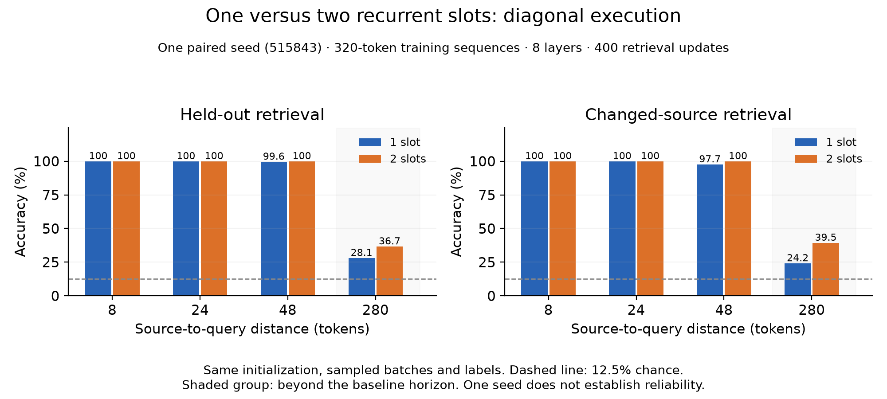

# One versus two recurrent slots: diagonal execution

One paired seed515843; eight layers, width48, four heads, ordinary window32, batch16, 320-token sequences and 400 retrieval updates. Both models use diagonal execution and identical initialization, ordered inputs, labels and optimizer budgets. The two-slot condition attends jointly to completed same-layer outputs at t−1 and t−2; the one-slot condition uses t−1. No parameters are added. Full-sequence backpropagation is retained.

Both models have 252,384 trainable parameters. Distance280 exceeds the nonrecurrent horizon 8 × (32−1) = 248. Training mixes distances8/24/48/280 uniformly in expectation. Each model processes 2,048,000 tokens and 6,400 answer targets. Evaluation uses 256 held-out examples per distance, validation seed2026; the answer token is excluded from each prompt. Chance is12.5%.

| Slots | Distance | Accuracy | Answer NLL | Changed-source accuracy | Prediction changes | Max source logit difference |
|---|---:|---:|---:|---:|---:|---:|
| 1 | 8 | 100.0% | 0.2291 | 100.0% | 100.0% | 8.3388 |
| 1 | 24 | 100.0% | 0.2138 | 100.0% | 100.0% | 7.9488 |
| 1 | 48 | 99.6% | 0.3559 | 97.7% | 100.0% | 7.50508 |
| 1 | 280 | 28.1% | 1.5770 | 24.2% | 51.6% | 6.52789 |
| 2 | 8 | 100.0% | 0.3549 | 100.0% | 100.0% | 6.99978 |
| 2 | 24 | 100.0% | 0.3277 | 100.0% | 100.0% | 7.22765 |
| 2 | 48 | 100.0% | 0.4615 | 100.0% | 100.0% | 5.91535 |
| 2 | 280 | 36.7% | 1.2132 | 39.5% | 85.2% | 5.5007 |

Answer NLL is in nats. Changed-source evaluation changes only the stored value to value+1 modulo8 and scores the new answer. Prediction changes and logit differences measure dependence on that source. Cached and whole-sequence logits agree within the checked floating-point tolerance.

At distance280, two slots attain **36.7%** accuracy versus **28.1%** for one slot (+8.6 percentage points). Changed-source accuracy is 39.5% versus 24.2%; answer NLL is 1.2132 versus 1.5770. These are measured outcomes of this configuration and budget, not an across-seed reliability result. There is one seed, so no between-seed standard deviation is available.

Two slots improve distant recall in this paired trial, but exact-value retrieval remains imperfect. The result supports partial learned relay when accompanied by changed-source accuracy; it does not establish reliable retrieval across seeds.

## Timing and retained state

| Slots | Training seconds | Seconds/update | Amortized logical KiB/sequence | Amortized backing KiB/sequence |
|---|---:|---:|---:|---:|
| 1 | 885.2 | 2.213 | 94.508 | 94.508 |
| 2 | 990.4 | 2.476 | 96.008 | 96.008 |

End-to-end wall time: 2034.5s. Serial workers, two PyTorch CPU threads each. Training time includes batch creation, forward/backward, clipping and optimizer updates; excludes final evaluation/save. The measured cache totals above are divided by their batch size256. Position metadata is shared, so these are amortized sizes, not batch-one totals. Backing storage includes sliced allocations; weights, training activations, allocator and Python overhead are excluded.

At batch one, float32 ordinary K/V retain93KiB (eight layers × 31 positions × two × width48 × four bytes). Completed recurrent outputs add1.5KiB for one slot or3KiB for two. Logical int64 position/cursor metadata adds2KiB, giving96.5KiB or98KiB total logical retained tensor state. This inference-state accounting does not claim a training-memory reduction.

Diagonal wavefronts batch independent token/layer nodes at equal t+layer. The [short thread-count benchmark](diagonal_benchmark.json) measured median two-slot updates of2.102s/1.556s/1.461s with one/two/four threads respectively (one warmup, three timed updates). This local measurement is separate from the complete training timings above; it is not a general hardware speedup claim.

## Historical context

The [previous sequential experiment](RESULTS-W32-HORIZON.md), using the same seed/data/budget, scored14.8% at280 with sliding32 and27.0% with one recurrent slot. Sliding predictions were exactly insensitive to the distant source. Those checkpoints provide context; the primary slot-count comparison here uses two freshly trained diagonal models. Diagonal and sequential implementations are mathematically equivalent but can differ in floating-point reductions and subsequent optimization trajectories. Different CPU thread counts also preclude treating historical timing as a controlled execution benchmark.

## Correctness and reproduction

Tests preserve exact default one-slot sequential behavior against the prior published code. An independent joint-softmax reference verifies one/two-slot diagonal forward values and all parameter gradients. Checks include causality, startup masking, full/token/chunk consistency, cache bounds, independent-example resets, a controlled forward/gradient dependency specifically through t−2, and an end-to-end source dependency beyond the baseline horizon (zero in the baseline, nonzero with diagonal recurrence). A connected graph alone is not evidence of successful retrieval; interpret the source-sensitive task scores above.

```bash
.venv/bin/python checks_recurrent.py
.venv/bin/python checks_diagonal.py
.venv/bin/python run_lateral_slots.py --output-dir results-lateral-slots-reproduction
.venv/bin/python summarize_lateral_slots.py
.venv/bin/pip install -r requirements-plots.txt
.venv/bin/python plot_lateral_slots.py
```

Use a new output directory to retrain. The summary and plot read the preserved default results directory. No prior checkpoint binaries are needed. [Configuration](lateral_slots_config.json), [raw measurements and source hashes](results-lateral-slots/runs.json), [architecture and execution design](DIAGONAL-LATERAL-DESIGN.md).


