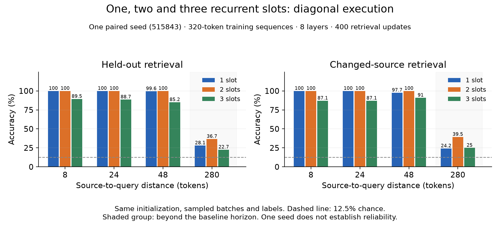

# Three recurrent connections: one new training run

Only the three-slot condition was newly trained. The one- and two-slot controls below are preserved measurements from the previous experiment, with no retraining or checkpoint re-evaluation. All three use diagonal execution, seed 515843, eight layers, width 48, four heads, ordinary W=32, batch 16, 320-token sequences and 400 retrieval updates. Initialization, ordered training inputs, labels, parameter count and budgets match by hashes. Each model processes 2,048,000 tokens and 6,400 answer targets.

Three slots attend jointly to completed outputs from the same layer at t−1, t−2 and t−3. Existing ln1 and K/V projections, including biases, are reused; there are no added parameters or positional embeddings. W remains 32 ordinary positions including the current token. Missing history is masked at startup. Full-sequence backpropagation is retained, and ordinary K/Vs remain separate from recurrent outputs in streaming state. Diagonal wavefronts remain valid: the added t−3 dependency arrives from three diagonals earlier.

Training mixes distances 8/24/48/280 uniformly in expectation. Distance 280 exceeds the nonrecurrent horizon 8 × 31 = 248. Evaluation uses the same 256 held-out examples per distance (seed 2026), excludes the answer token from the prompt, and checks full-sequence/cached equivalence. Chance is 12.5%.

| Slots | Distance | Accuracy | Answer NLL | Changed-source accuracy | Prediction changes | Max source logit difference |
|---|---:|---:|---:|---:|---:|---:|
| 1 | 8 | 100.0% | 0.2291 | 100.0% | 100.0% | 8.3388 |
| 1 | 24 | 100.0% | 0.2138 | 100.0% | 100.0% | 7.9488 |
| 1 | 48 | 99.6% | 0.3559 | 97.7% | 100.0% | 7.50508 |
| 1 | 280 | 28.1% | 1.5770 | 24.2% | 51.6% | 6.52789 |
| 2 | 8 | 100.0% | 0.3549 | 100.0% | 100.0% | 6.99978 |
| 2 | 24 | 100.0% | 0.3277 | 100.0% | 100.0% | 7.22765 |
| 2 | 48 | 100.0% | 0.4615 | 100.0% | 100.0% | 5.91535 |
| 2 | 280 | 36.7% | 1.2132 | 39.5% | 85.2% | 5.5007 |
| 3 | 8 | 89.5% | 0.4608 | 87.1% | 100.0% | 7.15584 |
| 3 | 24 | 88.7% | 0.4252 | 87.1% | 100.0% | 7.11922 |
| 3 | 48 | 85.2% | 0.4699 | 91.0% | 100.0% | 7.50077 |
| 3 | 280 | 22.7% | 1.5989 | 25.0% | 52.0% | 5.62836 |

At distance 280, three slots score **22.7%**, versus **36.7%** with two (-14.1 percentage points). Changed-source accuracy is 25.0% versus 39.5%; answer NLL is 1.5989 versus 1.2132. Changed-source evaluation substitutes value+1 modulo8 and checks that new answer. NLL is in nats.

Adding t−3 does not improve distant recall in this trial. This is a learning outcome under this configuration and budget, not proof that the connection cannot support relay. This is one paired seed; no between-seed standard deviation is available, and the result does not establish reliable learning across seeds.

Local recall also declines: three slots score85.2–89.5% across distances8/24/48, versus100% with two. The degradation is therefore broader than the beyond-horizon task alone.

## Timing and retained state

| Slots | Training seconds | Amortized logical KiB/sequence | Amortized backing KiB/sequence |
|---|---:|---:|---:|
| 1 | 885.2 | 94.508 | 94.508 |
| 2 | 990.4 | 96.008 | 96.008 |
| 3 | 1178.5 | 97.508 | 97.508 |

New three-slot end-to-end wall time: 1245.9s. All timings use two PyTorch CPU threads; the earlier runs were measured separately. Training timings include batch creation, forward/backward, clipping and optimizer updates, excluding evaluation/save. Cache totals are amortized over evaluation batch 256; shared position metadata is divided by that batch size. Weights, training activations and allocator/Python overhead are excluded.

At batch one, three slots retain 93 KiB of ordinary float32 K/Vs, 4.5 KiB of completed outputs and 2 KiB of logical position/cursor metadata: **99.5KiB** total logical tensor state. This is inference-state accounting, not a training-memory reduction.

## Reproduce

```bash
.venv/bin/python checks_diagonal.py
.venv/bin/python run_three_slots.py --output-dir results-three-slots-reproduction
.venv/bin/python summarize_three_slots.py
.venv/bin/python plot_three_slots.py
```

The runner trains only one model and verifies its data/initialization/budget hashes against the preserved controls. A new output directory retrains; summary and plot read the preserved default results. Tests include one/two/three-slot agreement with an independent joint-softmax reference (outputs and parameter gradients), full/token/chunk consistency, startup masking, future-token causality, resets, cache bounds, save/load, an isolated t−3 forward/gradient dependency and a controlled beyond-horizon source path.

[Training source snapshot](https://github.com/jefferythewind/attention-window-pilot/tree/f072388156954c6f7858778b89b689443e6f9c6e) · [Configuration](three_slots_config.json) · [New raw results and source hashes](results-three-slots/runs.json) · [Preserved controls](results-lateral-slots/runs.json) · [Diagonal execution design](DIAGONAL-LATERAL-DESIGN.md)


