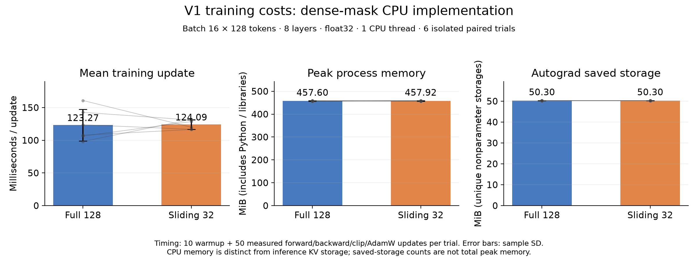

# V1 training time and CPU memory

Six isolated paired trials, full-128 versus sliding-32. This benchmarks the current dense-mask implementation; it does not benchmark an optimized sparse attention kernel.

| Measurement | Full 128 | Sliding 32 |
|---|---:|---:|
| Mean training update (Milliseconds / update) | 123.27 ± 24.25 | 124.09 ± 7.18 |
| Peak process memory (MiB (includes Python / libraries)) | 457.60 ± 1.13 | 457.92 ± 1.27 |
| Autograd saved storage (MiB (unique nonparameter storages)) | 50.30 ± 0.00 | 50.30 ± 0.00 |

Mean paired sliding/full update-time ratio: **1.040** (SD 0.216).

## How to read this comparison

A smaller attention window currently changes a dense boolean mask. Every layer still processes the complete 128-token sequence, and the SDPA call receives the same Q/K/V shapes. The implementation therefore does not guarantee reduced attention work or reduced training memory. Timing differences are specific to the current CPU kernel, machine, and small shapes.

Peak process RSS includes Python, imported libraries, the corpus, all 60 prebuilt batches, weights, optimizer state, activations and allocator behavior. Each condition gets a fresh process, avoiding contamination from the other condition, but RSS remains a coarse process-level measurement. Baseline and post-warmup RSS are recorded in raw JSON. It is not a measurement of GPU VRAM.

Autograd saved storage is deduplicated nonparameter tensor storage captured during one forward/backward step. It includes inputs and excludes weights; it is a diagnostic of tensors retained for backward, not total memory, peak activation memory or cumulative allocation traffic. Weight and optimizer tensor sizes match exactly across paired conditions.

Inference KV storage remains 93 KiB per sequence for W=32 versus 381 KiB for W=128 (24.4%). That saving does not imply the same reduction in training memory.

## Protocol

Fresh process per seed/condition, serial alternating order, 10 warmup + 50 timed updates. Prebuilt identical text batches; forward/backward/clip/AdamW timed. No evaluation, IO or data sampling in timed region. Fixed peak learning rate; microbenchmark is not a retraining result.

PyTorch 2.14.1+cpu; CPU: INTEL(R) XEON(R) PLATINUM 8573C. Both conditions use identical initialization and prebuilt text batches for each seed, verified by hashes. Timing is serial, alternating condition order across seeds. All threads are set to one. The benchmark holds learning rate at 0.002; it is not a new training-quality experiment.

Times are means over 50 steady-state updates; reported dispersion is across the six process trials. No statistical speedup claim is made. For performance per second, use the learning curves with appropriately measured end-to-end training times, rather than assuming kernel timing equals the full pipeline.

Reproduce: `.venv/bin/python benchmark_training.py`, then `.venv/bin/python summarize_training_cost.py`. Raw results: [results-training-cost/benchmark.json](results-training-cost/benchmark.json).

