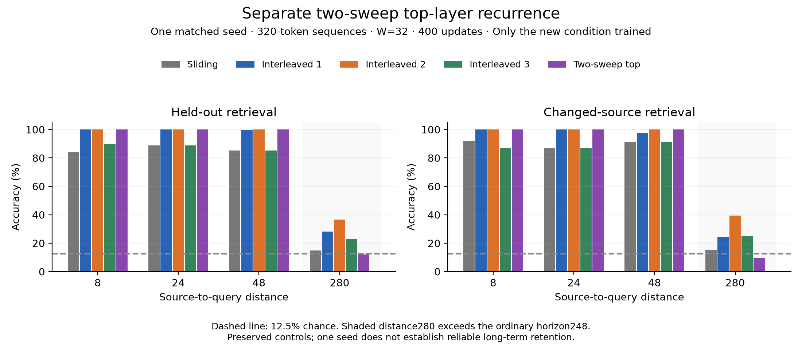

# Top-layer-only two-sweep attention: separate variant

This is the separately retained top-only variant, not the intended all-layer zigzag experiment. Only the top-only model was trained for these measurements. The ordinary sliding and interleaved one/two/three-slot measurements are preserved controls, without retraining. All use seed 515843, eight layers, width 48, four heads, ordinary W=32, batch 16, 320-token full sequences, 400 retrieval updates and the same AdamW recipe. Initialization, ordered inputs, labels, parameter counts, processed tokens, answer targets and update budgets match by hashes. The new lateral window is also 32. No text models were trained.

The ordinary backbone runs first without alteration. A separate top-only sweep then attends to completed corrected-state history K/Vs and the current ordinary U self slot, reusing the existing top block’s LN1/Q/K/V/output weights and biases. It adds no MLP, gate, embedding or parameter. Both sweeps retain the full training graph. Lower corrected rows are deliberately absent: without extra supervision or vertical integration they would not reach the existing top-only head. This is a new architecture, not an equivalent implementation of the interleaved recurrence.

## Beyond-horizon retrieval

Distance 280 exceeds the ordinary horizon 8 × (32−1) = 248. Evaluation uses the same 256 examples per distance, validation seed 2026; exact percentages below have denominator 256. Chance is 12.5%. The answer token is excluded from the prompt. Changed-source evaluation substitutes value+1 modulo8 while leaving the other prompt tokens fixed and scores the new answer.

| Condition | Accuracy d280 | Answer NLL | Changed-source accuracy | Prediction changes | Max source logit difference |
|---|---:|---:|---:|---:|---:|
| sliding-32 | 14.84375% | 2.086428 | 15.234375% | 0% | 0 |
| recurrent-1slot-diagonal | 28.125% | 1.576981 | 24.21875% | 51.5625% | 6.52789 |
| recurrent-2slot-diagonal | 36.71875% | 1.213235 | 39.453125% | 85.15625% | 5.5007 |
| recurrent-3slot-diagonal | 22.65625% | 1.598892 | 25% | 51.953125% | 5.62836 |
| two-sweep-top-recurrent-w32 | 12.109375% | 2.083600 | 9.765625% | 0% | 2.86102e-06 |

The new model retrieves 31/256 original values and 25/256 changed-source values. Source substitution changes predictions on 0/256 examples. Mean absolute source-induced logit difference is 6.5309e-08. These task scores assess learned source-sensitive relay; the separate controlled gradient test only establishes a dependency path. One seed has no between-seed standard deviation and cannot establish reliable or arbitrary-distance memory.

The new model reaches 100% at distances 8/24/48 but is near chance at 280, with no source-induced prediction changes. This configuration failed to learn useful beyond-horizon retrieval within 400 updates. The controlled graph checks establish capacity for a dependency path, not successful learning or proof that the architecture cannot relay information.

## All retrieval distances

| Condition | Distance | Exact accuracy | Answer NLL | Changed-source accuracy |
|---|---:|---:|---:|---:|
| sliding-32 | 8 | 83.984375% | 0.264189 | 91.796875% |
| sliding-32 | 24 | 88.671875% | 0.258089 | 87.109375% |
| sliding-32 | 48 | 85.15625% | 0.263565 | 91.015625% |
| sliding-32 | 280 | 14.84375% | 2.086428 | 15.234375% |
| recurrent-1slot-diagonal | 8 | 100% | 0.229098 | 100% |
| recurrent-1slot-diagonal | 24 | 100% | 0.213835 | 100% |
| recurrent-1slot-diagonal | 48 | 99.609375% | 0.355941 | 97.65625% |
| recurrent-1slot-diagonal | 280 | 28.125% | 1.576981 | 24.21875% |
| recurrent-2slot-diagonal | 8 | 100% | 0.354909 | 100% |
| recurrent-2slot-diagonal | 24 | 100% | 0.327735 | 100% |
| recurrent-2slot-diagonal | 48 | 100% | 0.461511 | 100% |
| recurrent-2slot-diagonal | 280 | 36.71875% | 1.213235 | 39.453125% |
| recurrent-3slot-diagonal | 8 | 89.453125% | 0.460820 | 87.109375% |
| recurrent-3slot-diagonal | 24 | 88.671875% | 0.425190 | 87.109375% |
| recurrent-3slot-diagonal | 48 | 85.15625% | 0.469914 | 91.015625% |
| recurrent-3slot-diagonal | 280 | 22.65625% | 1.598892 | 25% |
| two-sweep-top-recurrent-w32 | 8 | 100% | 0.134550 | 100% |
| two-sweep-top-recurrent-w32 | 24 | 100% | 0.134503 | 100% |
| two-sweep-top-recurrent-w32 | 48 | 100% | 0.135343 | 100% |
| two-sweep-top-recurrent-w32 | 280 | 12.109375% | 2.083600 | 9.765625% |

## Complete training durations

| Condition | Threads | Training seconds |
|---|---:|---:|
| sliding-32 | 1 | 179.3 |
| recurrent-1slot-diagonal | 2 | 885.2 |
| recurrent-2slot-diagonal | 2 | 990.4 |
| recurrent-3slot-diagonal | 2 | 1178.5 |
| two-sweep-top-recurrent-w32 | 2 | 387.7 |

New end-to-end wall time: 412.0s. New training worker peak process RSS before final evaluation: **721.5MiB**. This includes runtime, weights, optimizer, inputs and allocator storage, not only activations. Full training timings include sampling, forward/backward, clipping and optimizer steps, but exclude final evaluation/save. Existing controls were measured separately; the older ordinary sliding run used one thread. Do not infer a controlled architectural speedup from those historical durations.

## Common checkpoint cost profiles

Each saved checkpoint is measured in a fresh process, on the same CPU with two threads. No optimizer updates occur and weights remain bitwise unchanged. Training forward/backward is one fixed batch 16 × 320 pass, without warmup or optimizer; its timing is a diagnostic, not a converged steady-state training benchmark. Prefill and decoding use two warmups, five timed full-prefill calls and twenty timed one-token calls from a frozen prefix. Median latencies are reported separately.

| Condition | Fixed-batch forward/backward ms | Peak process RSS MiB | Autograd saved storage MiB |
|---|---:|---:|---:|
| sliding-32 | 236.3 | 474.5 | 127.8 |
| recurrent-1slot-diagonal | 1775.7 | 1317.0 | 678.4 |
| recurrent-2slot-diagonal | 1932.5 | 1253.8 | 709.0 |
| recurrent-3slot-diagonal | 2288.3 | 1269.0 | 747.0 |
| two-sweep-top-recurrent-w32 | 545.5 | 590.3 | 192.6 |

RSS is the process high-water mark during the training pass, including imports/weights/inputs. Autograd storage deduplicates saved allocations and includes parameters/inputs; it is not peak process memory. These differ from the full-run worker peak above.

| Condition | Batch | 319-token prefill ms | Cached one-token decode ms |
|---|---:|---:|---:|
| sliding-32 | 1 | 7.437 | 1.125 |
| sliding-32 | 16 | 73.567 | 2.032 |
| recurrent-1slot-diagonal | 1 | 180.031 | 4.921 |
| recurrent-1slot-diagonal | 16 | 441.968 | 7.035 |
| recurrent-2slot-diagonal | 1 | 186.399 | 5.138 |
| recurrent-2slot-diagonal | 16 | 439.708 | 7.212 |
| recurrent-3slot-diagonal | 1 | 189.650 | 5.417 |
| recurrent-3slot-diagonal | 16 | 442.511 | 7.173 |
| two-sweep-top-recurrent-w32 | 1 | 31.889 | 1.392 |
| two-sweep-top-recurrent-w32 | 16 | 126.031 | 2.688 |

Batch-one two-sweep prefill is 5.65× faster than the saved one-slot interleaved model in this measurement; cached decoding is 3.54× faster. These are local latency comparisons between different architectures and learned behaviors, not evidence of equal capability or general hardware speedup.

## Retained streaming tensors and temporary grid

Batch-one state immediately after 319-token prefill. Ordinary and recurrent KV are distinct; older interleaved models instead retain completed output states. Actual backing allocations can exceed logical window sizes because the older paths return slices; the two-sweep path compacts its returned cache. This allocation-policy difference is separate from the architectural state budget.

| Condition | Ordinary KV KiB | Recurrent KV KiB | Recurrent output KiB | Metadata KiB | Logical total KiB | Backing KiB |
|---|---:|---:|---:|---:|---:|---:|
| sliding-32 | 93.000 | 0.000 | 0.000 | 1.938 | 94.938 | 1437.992 |
| recurrent-1slot-diagonal | 93.000 | 0.000 | 1.500 | 2.000 | 96.500 | 96.562 |
| recurrent-2slot-diagonal | 93.000 | 0.000 | 3.000 | 2.000 | 98.000 | 98.062 |
| recurrent-3slot-diagonal | 93.000 | 0.000 | 4.500 | 2.000 | 99.500 | 99.562 |
| two-sweep-top-recurrent-w32 | 93.000 | 11.625 | 0.000 | 2.188 | 106.812 | 106.812 |

The new model explicitly materializes the completed first-sweep grid U[1..8]: **7.500MiB** for training batch 16 × 320 × width 48, excluding embeddings and other activations. The corresponding batch-one 319-token prefill grid is **478.500KiB**. This grid is temporary; it is not retained streaming state. Autograd also retains other tensors, captured separately by the saved-storage measurement. The parallel lateral Q/K/V projection is another 2.8125MiB at training shape, not included in the grid count. RSS already includes these tensors; the grid and saved-storage counts describe overlapping parts of memory. These volumes are not total or peak activation memory.

No total-memory reduction is assumed: a top-row recurrent KV history adds 31 × two × width 48 × four bytes = 11.625KiB at batch one, on top of ordinary KV storage.

## Correctness and reproduction

Acceptance checks passed for baseline-mode exact outputs/gradients, ordinary first-sweep/grid/cache equivalence, independent corrected-history reference values/gradients, top-corrected readout and lower-backbone gradients, causal future/answer exclusion, full/token/chunk consistency, startup/reset/cache/absolute-position handling, completed-R intervention, a controlled beyond-horizon forward/gradient dependency, no new parameters and save/load. No optional all-row mode is implemented.

```bash
.venv/bin/python checks_two_sweep.py
.venv/bin/python run_two_sweep.py --output-dir results-two-sweep-reproduction
.venv/bin/python measure_two_sweep.py
.venv/bin/python summarize_two_sweep.py
.venv/bin/python plot_two_sweep.py
```

Use a new output directory to train only the new condition. Cost comparisons require the locally saved historical checkpoint binaries; they are excluded from Git. On a fresh clone, measure the new saved checkpoint with `measure_two_sweep.py --checkpoint PATH`. Report/plot read the preserved default output. Plotting dependencies are in requirements-plots.txt.

Training revision: [419750a](https://github.com/jefferythewind/attention-window-pilot/tree/419750ad7cc951f6a6a2905a71f39f2ad4daece4). [Raw retrieval results and exact source hashes](results-two-sweep/runs.json) · [Raw costs](results-two-sweep/costs.json) · [Configuration](two_sweep_config.json) · [Architecture, measurement definitions and checks](TWO-SWEEP-DESIGN.md).


