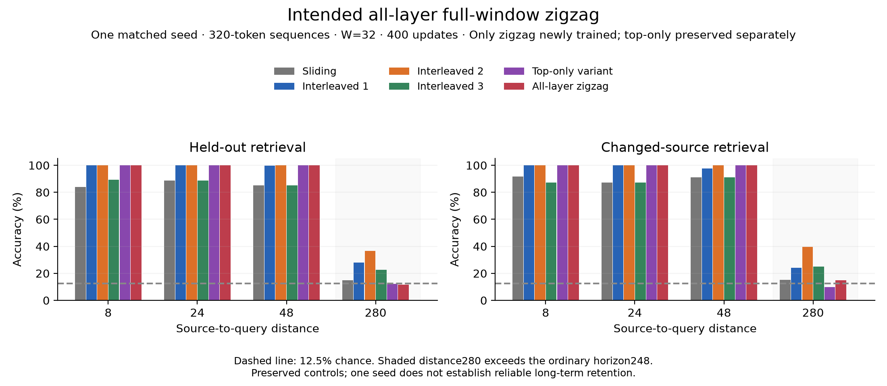

# Intended all-layer full-window zigzag: one exploratory seed

Only the all-layer zigzag condition was newly trained. The completed top-layer-only two-sweep trial is a separate variant; its saved results are included for comparison. Ordinary sliding and earlier interleaved recurrent conditions are also preserved, without retraining or re-evaluating their retrieval checkpoints.

Each ordinary layer consumes the preceding corrected row R, produces U after its ordinary attention/residual/MLP, then receives a full-window same-layer recurrent correction. Its corrected R feeds the next ordinary layer. Historical lateral K/Vs come from this layer’s completed R; the current temporary self slot comes from U. Reused LN1/Q/K/V/output weights and biases add no parameter, second MLP, gate or positional embedding. Every corrected row has a verified path to the final head and loss.

The protocol remains 320-token complete sequences, eight layers, width 48, four heads, ordinary and lateral W=32, batch 16, seed 515843, 400 retrieval updates, distances 8/24/48/280, the original optimizer and two CPU threads. Initialization, training inputs/labels and token/target/update budgets match by hashes. Training retains the complete autograd graph. Evaluation uses the same 256 held-out examples per distance, seed 2026, with the answer token excluded from the prompt. Chance is 12.5%; exact percentages below have denominator 256.

## Main comparison at distance 280

| Condition | Exact accuracy | Answer NLL | Changed-source accuracy | Prediction changes | Max source logit difference |
|---|---:|---:|---:|---:|---:|
| sliding-32 | 14.84375% | 2.086428 | 15.234375% | 0% | 0 |
| recurrent-1slot-diagonal | 28.125% | 1.576981 | 24.21875% | 51.5625% | 6.52789 |
| recurrent-2slot-diagonal | 36.71875% | 1.213235 | 39.453125% | 85.15625% | 5.5007 |
| recurrent-3slot-diagonal | 22.65625% | 1.598892 | 25% | 51.953125% | 5.62836 |
| two-sweep-top-recurrent-w32 | 12.109375% | 2.083600 | 9.765625% | 0% | 2.86102e-06 |
| zigzag-all-layer-recurrent-w32 | 11.71875% | 2.131937 | 14.84375% | 0% | 3.8147e-06 |

Zigzag recalls 30/256 original values and 38/256 changed-source values. Source substitution changes predictions on 0/256 examples; mean absolute source-induced logit difference is 3.59025e-07. Changed-source evaluation changes only the stored value to value+1 modulo8 and checks that new answer. Answer NLL is in nats.

Zigzag reaches 100% recall at distances 8/24/48 but remains near chance at 280, with no source-induced prediction changes. This configuration failed to learn useful distant retrieval under 400 updates; it is not evidence that the verified connection cannot support relay.

Distance 280 exceeds the original ordinary horizon 8 × 31 = 248. However, U-only local history in two attention operations per layer would have finite reach 2 × 8 × 31 = 496. Thus successful source-sensitive retrieval at 280 is beyond the original backbone’s horizon but cannot isolate recurrent-history relay from the added finite attention depth. A short controlled source test beyond both corresponding small-model bounds verifies the recurrent dependency path. These are separate claims; graph connectivity alone does not establish learned unbounded memory. One seed has no between-seed standard deviation and cannot establish reliable learning across seeds.

## All distances

| Condition | Distance | Exact accuracy | Answer NLL | Changed-source accuracy |
|---|---:|---:|---:|---:|
| sliding-32 | 8 | 83.984375% | 0.264189 | 91.796875% |
| sliding-32 | 24 | 88.671875% | 0.258089 | 87.109375% |
| sliding-32 | 48 | 85.15625% | 0.263565 | 91.015625% |
| sliding-32 | 280 | 14.84375% | 2.086428 | 15.234375% |
| recurrent-1slot-diagonal | 8 | 100% | 0.229098 | 100% |
| recurrent-1slot-diagonal | 24 | 100% | 0.213835 | 100% |
| recurrent-1slot-diagonal | 48 | 99.609375% | 0.355941 | 97.65625% |
| recurrent-1slot-diagonal | 280 | 28.125% | 1.576981 | 24.21875% |
| recurrent-2slot-diagonal | 8 | 100% | 0.354909 | 100% |
| recurrent-2slot-diagonal | 24 | 100% | 0.327735 | 100% |
| recurrent-2slot-diagonal | 48 | 100% | 0.461511 | 100% |
| recurrent-2slot-diagonal | 280 | 36.71875% | 1.213235 | 39.453125% |
| recurrent-3slot-diagonal | 8 | 89.453125% | 0.460820 | 87.109375% |
| recurrent-3slot-diagonal | 24 | 88.671875% | 0.425190 | 87.109375% |
| recurrent-3slot-diagonal | 48 | 85.15625% | 0.469914 | 91.015625% |
| recurrent-3slot-diagonal | 280 | 22.65625% | 1.598892 | 25% |
| two-sweep-top-recurrent-w32 | 8 | 100% | 0.134550 | 100% |
| two-sweep-top-recurrent-w32 | 24 | 100% | 0.134503 | 100% |
| two-sweep-top-recurrent-w32 | 48 | 100% | 0.135343 | 100% |
| two-sweep-top-recurrent-w32 | 280 | 12.109375% | 2.083600 | 9.765625% |
| zigzag-all-layer-recurrent-w32 | 8 | 100% | 0.481073 | 100% |
| zigzag-all-layer-recurrent-w32 | 24 | 100% | 0.463528 | 100% |
| zigzag-all-layer-recurrent-w32 | 48 | 100% | 0.492379 | 100% |
| zigzag-all-layer-recurrent-w32 | 280 | 11.71875% | 2.131937 | 14.84375% |

## Training durations

| Condition | Threads | Training seconds |
|---|---:|---:|
| sliding-32 | 1 | 179.3 |
| recurrent-1slot-diagonal | 2 | 885.2 |
| recurrent-2slot-diagonal | 2 | 990.4 |
| recurrent-3slot-diagonal | 2 | 1178.5 |
| two-sweep-top-recurrent-w32 | 2 | 387.7 |
| zigzag-all-layer-recurrent-w32 | 2 | 1458.8 |

New zigzag wall time including evaluation/save: 1543.5s. Full-run peak training-worker process RSS before evaluation: **1770.2MiB**. RSS includes runtime, model, optimizer, inputs and allocator storage. Training durations include sampling, forward/backward, clipping and updates, excluding final evaluation/save. Earlier durations were measured separately; ordinary sliding used one thread. They are historical measurements, not a controlled training-speedup benchmark.

## Common checkpoint measurements

Profiles use the same CPU and two threads. Older checkpoint profiles are preserved; only zigzag is newly profiled. Each uses a fresh process, one fixed batch 16 × 320 forward/backward pass with no optimizer update, and bitwise-unchanged parameters. Prefill/decode use two warmups, five 319-token prefills and twenty one-token calls from the same frozen prefix. Medians are separate. A cold single forward/backward timing is diagnostic, not a steady-state training benchmark.

| Condition | Forward/backward ms | Peak training-pass RSS MiB | Unique autograd saved storage MiB |
|---|---:|---:|---:|
| sliding-32 | 236.3 | 474.5 | 127.8 |
| recurrent-1slot-diagonal | 1775.7 | 1317.0 | 678.4 |
| recurrent-2slot-diagonal | 1932.5 | 1253.8 | 709.0 |
| recurrent-3slot-diagonal | 2288.3 | 1269.0 | 747.0 |
| two-sweep-top-recurrent-w32 | 545.5 | 590.3 | 192.6 |
| zigzag-all-layer-recurrent-w32 | 2843.6 | 1387.1 | 645.8 |

RSS includes process/runtime/weights; unique autograd storage deduplicates saved allocations and includes parameters/inputs. Those are different measures from the actual full-run peak above.

| Condition | Batch | Prefill ms | Cached decode ms |
|---|---:|---:|---:|
| sliding-32 | 1 | 7.437 | 1.125 |
| sliding-32 | 16 | 73.567 | 2.032 |
| recurrent-1slot-diagonal | 1 | 180.031 | 4.921 |
| recurrent-1slot-diagonal | 16 | 441.968 | 7.035 |
| recurrent-2slot-diagonal | 1 | 186.399 | 5.138 |
| recurrent-2slot-diagonal | 16 | 439.708 | 7.212 |
| recurrent-3slot-diagonal | 1 | 189.650 | 5.417 |
| recurrent-3slot-diagonal | 16 | 442.511 | 7.173 |
| two-sweep-top-recurrent-w32 | 1 | 31.889 | 1.392 |
| two-sweep-top-recurrent-w32 | 16 | 126.031 | 2.688 |
| zigzag-all-layer-recurrent-w32 | 1 | 234.159 | 2.590 |
| zigzag-all-layer-recurrent-w32 | 16 | 457.769 | 4.948 |

## Retained streaming state and temporary activations

Batch-one tensor state after 319-token prefill. Old output-state recurrence and new corrected-history KV recurrence have different budgets. Older ordinary cache slices may retain full prefill allocations; compact returned caches in the new modes avoid that backing-storage effect. Weights, activations, allocator and Python overhead are excluded from retained-state totals.

| Condition | Ordinary KV KiB | Recurrent KV KiB | Recurrent output KiB | Metadata KiB | Logical total KiB | Backing KiB |
|---|---:|---:|---:|---:|---:|---:|
| sliding-32 | 93.000 | 0.000 | 0.000 | 1.938 | 94.938 | 1437.992 |
| recurrent-1slot-diagonal | 93.000 | 0.000 | 1.500 | 2.000 | 96.500 | 96.562 |
| recurrent-2slot-diagonal | 93.000 | 0.000 | 3.000 | 2.000 | 98.000 | 98.062 |
| recurrent-3slot-diagonal | 93.000 | 0.000 | 4.500 | 2.000 | 99.500 | 99.562 |
| two-sweep-top-recurrent-w32 | 93.000 | 11.625 | 0.000 | 2.188 | 106.812 | 106.812 |
| zigzag-all-layer-recurrent-w32 | 93.000 | 93.000 | 0.000 | 3.883 | 189.883 | 189.883 |

Diagnostic grid instrumentation counts a zigzag U row at **0.938MiB** for batch 16 × 320 × width 48. U across all layers has logical volume **7.500MiB**; R across all layers has volume **7.500MiB**. Default inference does not retain lists of all these rows; these totals are not simultaneous peak temporary allocations. Each batch-one 319-token U row is 59.8125KiB. Training autograd retains tensors required for backward, measured separately above. Grid/saved-storage counts overlap with process RSS and are not disjoint sums. No total-memory reduction is assumed.

## Acceptance checks and reproduction

Independent explicit all-layer reference values and parameter gradients passed. Tests verify corrected previous-row inputs, a real nonzero gradient to every R row, completed same-row R-history intervention, causal/full/token/chunk consistency, cache/window/startup/reset/independent-example/absolute-position handling, save/load, and a controlled source beyond both the ordinary and U-only finite test horizons. Top-only and baseline regression checks also passed. No auxiliary supervision or silent cross-row lateral attention was introduced.

```bash
.venv/bin/python checks_zigzag.py
.venv/bin/python checks_two_sweep.py
.venv/bin/python run_zigzag.py --output-dir results-zigzag-reproduction
.venv/bin/python measure_two_sweep.py --checkpoint PATH_TO_ZIGZAG_CHECKPOINT
.venv/bin/python summarize_zigzag.py
.venv/bin/python plot_zigzag.py
```

Only zigzag is trained in the new output directory. Comparison retrieval/cost metrics are preserved; checkpoint binaries are not published. The cost worker prints JSON for the supplied checkpoint. Reports/plots read the preserved default results. Plot dependencies are in requirements-plots.txt.

Training revision: [6b513b4](https://github.com/jefferythewind/attention-window-pilot/tree/6b513b4bff97e29563293ea329eea41a8cccfdc2). [Configuration](zigzag_config.json) · [Raw zigzag results and source hashes](results-zigzag/runs.json) · [New cost profile](results-zigzag/costs.json) · [Intended architecture and checks](ZIGZAG-DESIGN.md) · [Separate top-only variant](RESULTS-TWO-SWEEP.md).


